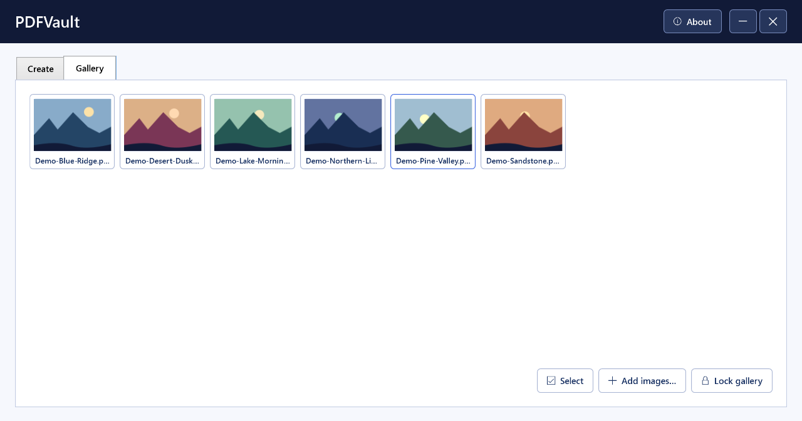
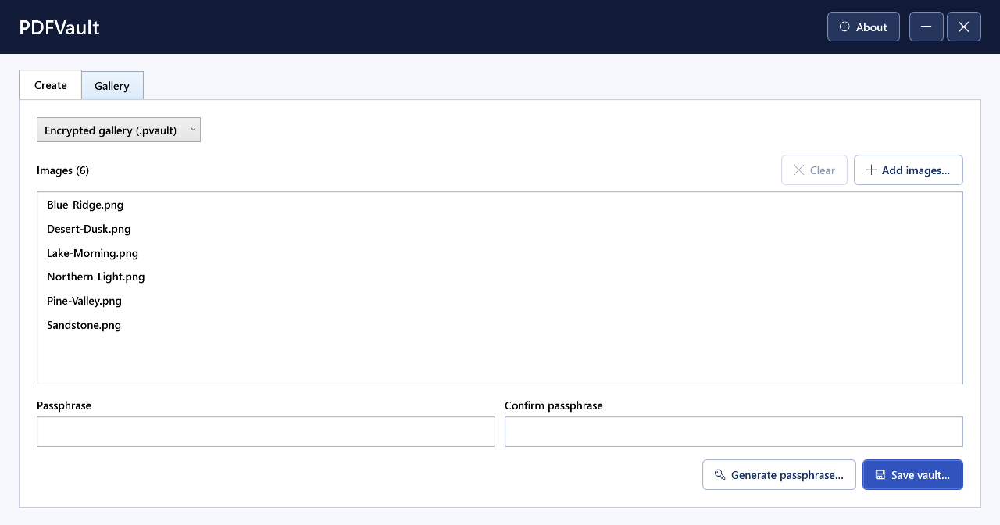
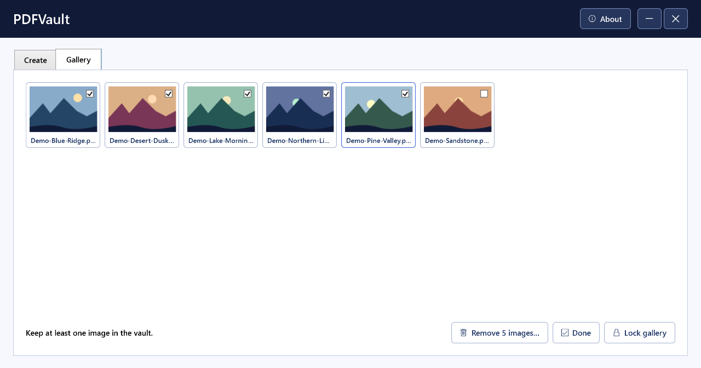
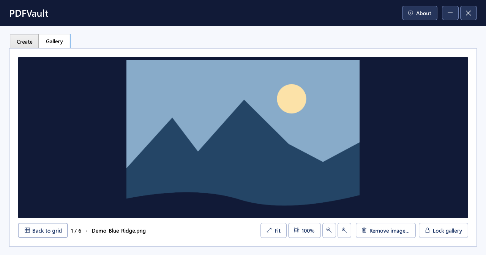

# PDFVault


PDFVault is a Windows desktop app for creating, viewing, and editing password-protected image galleries. It works locally and doesn’t require an account.

**[Download PDFVault for Windows](https://github.com/ravhirizaldi/PDFVault/releases/latest)** · Created by [Ravhi Rizaldi](https://github.com/ravhirizaldi)



## Getting started

1. Install the [.NET 8 Desktop Runtime for Windows x64](https://dotnet.microsoft.com/download/dotnet/8.0) if it isn’t already installed, then run `PDFVault.exe`.
2. On **Create**, add images, set a passphrase, and save a `.pvault` file. You can also attach the encrypted bundle to a new or existing PDF.
3. On **Gallery**, open the vault and enter its passphrase. Click a thumbnail to view it. Use **Fit**, **100%**, or **Ctrl + mouse wheel** to zoom, and drag the image to pan.
4. To edit, use **Add images…** or enter **Select** mode to remove multiple images at once. Edits require the passphrase, and at least one image must remain.

## Screenshots

| Create a vault | Select images for removal | Photo viewer |
| --- | --- | --- |
| [](screenshots/create.png) | [](screenshots/selection.png) | [](screenshots/viewer.png) |

## Security and limits

- New vaults use AES-256-CBC with HMAC-SHA256 and PBKDF2-HMAC-SHA256 (600,000 iterations). Use a unique, randomly generated passphrase; there’s no passphrase recovery.
- A PDF’s visible pages remain unencrypted. The appended encrypted gallery can be detected, and PDF editors or optimizers may remove it. Keep an untouched backup.
- The app doesn’t extract gallery images to a folder. Viewing still requires plaintext in memory. The gallery locks after five minutes of inactivity or when Windows locks; it is not protection against a compromised computer.
- The encrypted image bundle is limited to 512 MiB. A single preview is limited to 128 MiB and 64 megapixels. The release executable is unsigned.

## Build from source

With the .NET 8 SDK installed, run from the repository root:

```sh
dotnet publish Wpf/PDFVault.csproj -c Release -o release
```

This produces `release/PDFVault.exe`, a single-file Windows x64 build that uses the installed .NET Desktop Runtime.
